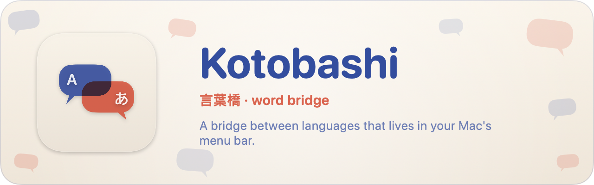

<!-- This file is published publicly (it is copied to the public repo kotobashi-releases when it changes). Do not put private information in it. -->

# Kotobashi

<a href="https://github.com/riczescaran/kotobashi-releases/releases/latest">Download the latest release</a>

Kotobashi is a simple companion app for working across languages on your Mac. It translates, proofreads, and rewrites text in any app, reads text from the screen, and follows conversations with live translated captions.

*About the name:* *kotoba* (言葉) means "words" and *hashi* (橋) means "bridge" in Japanese, so Kotobashi is a bridge for your words.

This repository only hosts the release downloads and the in-app update feed. The source code is kept private.

## Features

- **Translate and rewrite in any app.** Select text and press a shortcut (⌃⌥T to translate, ⌃⌥R to rewrite; both can be changed), click the small button that appears next to your selection, or right-click → Services.
- **Translate** detects the language for you. English goes to Japanese and everything else to English by default; you can change both languages and switch the direction.
- **Rewrite** text in its own language with a style: Proofread (fixes spelling, grammar, punctuation and clearly wrong words, and keeps your wording), Natural, Professional, Concise, Friendly, or your own styles.
- **Work with the result:** rewrites highlight what changed, *Check meaning* translates a translation back so you can see whether the meaning survived, *Replace* pastes the result over your selection, and line breaks and indentation are kept.
- **Translate from the screen** (⌃⌥O): drag a box over an image, a video or a PDF, and Kotobashi reads the text on your Mac and translates it.
- **Live translated captions** (⌃⌥L) for your microphone, one app (for example a Slack huddle) or both, in a floating bar, with a transcript you can copy or save. Speech recognition and translation run on your Mac.
- **Choose your AI:** your Claude or ChatGPT subscription (through the Claude Code or Codex command-line tools), an Anthropic or OpenAI API key, or Apple's on-device translation and Apple Intelligence. If the chosen provider fails, Kotobashi can fall back to Apple's on-device options (on by default) and tells you why.
- **History** of your translations and rewrites, with search, favorites and CSV export.
- **Stays out of your way:** show it in the menu bar, the Dock, or both.

## Install

1. Download the latest `Kotobashi-<version>.dmg` from [Releases](https://github.com/riczescaran/kotobashi-releases/releases/latest).
2. Open the `.dmg` and drag Kotobashi onto the Applications folder.
3. Open Kotobashi. The first time, macOS says "Apple could not verify Kotobashi is free of malware". Click **Done**.
4. Open System Settings → Privacy & Security, scroll down to the Kotobashi message, and click **Open Anyway**. Confirm with your password.

Requires macOS 26 or later.

## Updates

From the version that includes the updater onward, Kotobashi checks for new versions itself and installs them in the app (menu bar → Check for Updates…). Updates installed this way don't need the "Open Anyway" step again.
